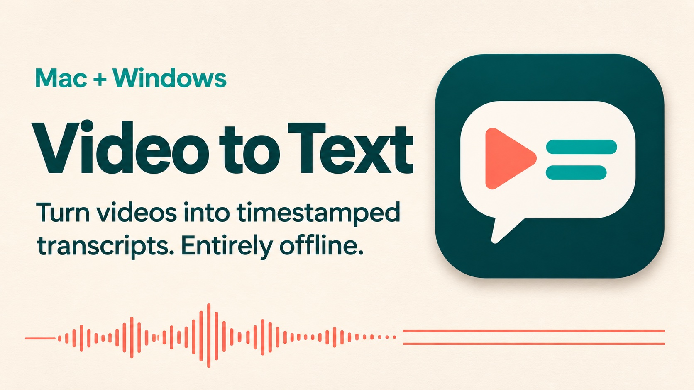

# Video to Text

Turn a local video into an editable transcript with timestamps and numbered speakers. The Mac and Windows apps include the speech models and run offline from the first launch. Your video, temporary audio and transcript stay on your computer.

## Download

| Computer | Download from GitHub Releases |
| --- | --- |
| Mac with Apple silicon | [Mac disk image](https://github.com/msoruc/video-to-text/releases/latest/download/Video-to-Text-macOS-arm64.dmg) |
| Windows x64 PC | [Windows installer](https://github.com/msoruc/video-to-text/releases/latest/download/Video-to-Text-Windows-x64-Setup.exe) |
| Windows x64 PC, portable folder | [Windows ZIP](https://github.com/msoruc/video-to-text/releases/latest/download/Video-to-Text-Windows-x64.zip) |

Download once, or copy the installer to an offline computer by USB. The packaged app includes Python, FFmpeg and all three models.

## First transcript

1. Install and open **Video to Text**.
2. Click **Choose Video…** and select a video with an audio track.
3. Set **Number of speakers**. Choose **2** for a two-person conversation, or **Auto** if you do not know.
4. Click **Transcribe** and keep the window open. Review the transcript, edit any words or speaker labels, then click **Save Text…**.

Try the [two-speaker sample](Sample/Two%20speakers.mp4) and compare your result with its [example transcript](Sample/Two%20speakers.txt).

## Documentation

- [Installation, usage and troubleshooting](docs/guide.md)
- [Running or building from source](docs/build.md)
- [Components and model sources](docs/components.md)

The Mac app was tested on Apple silicon, including offline transcription. The Windows installer payload was verified on Mac. A native Windows installation test is still pending.
